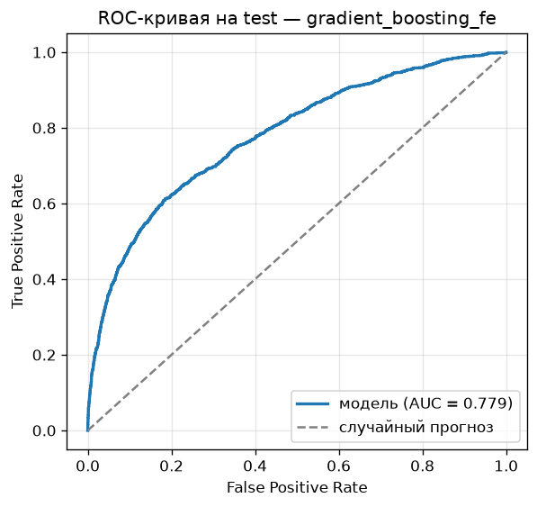
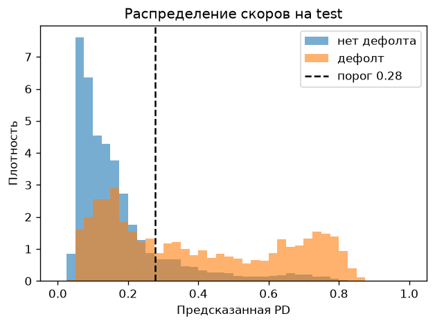
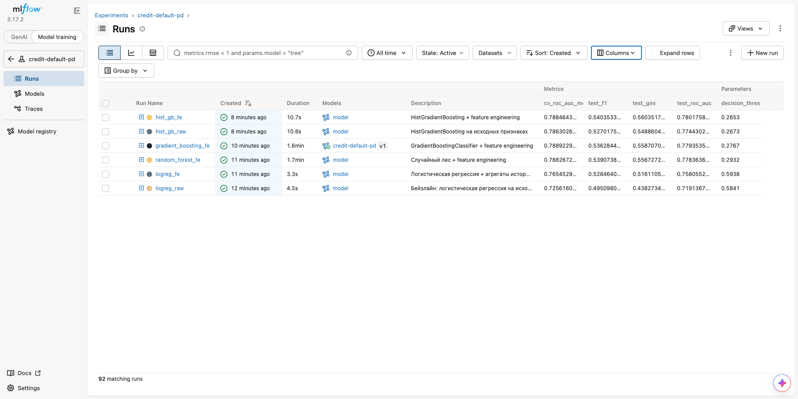
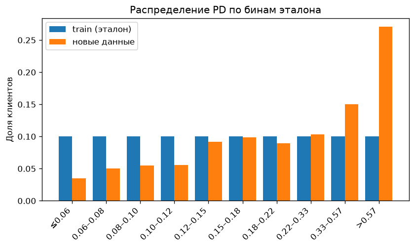

# Пайплайн PD-модели для клиентов кредитных карт

[](https://github.com/deepmindme/credit-pd-pipeline/actions/workflows/ci-cd.yml)

Итоговый проект по курсу «Автоматизация процессов разработки и тестирования моделей машинного
обучения». Задача: автоматизировать весь жизненный цикл PD-модели (probability of default),
которая оценивает вероятность того, что клиент кредитной карты допустит дефолт в следующем
месяце. Цепочка выглядит так: проверка входящих данных → подготовка → обучение с подбором
гиперпараметров → учёт экспериментов → версионирование → тесты в CI → REST API в Docker →
мониторинг дрифта.

Датасет: [Default of Credit Card Clients](https://archive.ics.uci.edu/dataset/350/default+of+credit+card+clients)
(UCI, 30 000 клиентов тайваньского банка, 2005 год; версия с
[Kaggle](https://www.kaggle.com/datasets/uciml/default-of-credit-card-clients-dataset)).

## Результат

Лучшая модель: `GradientBoostingClassifier` с feature engineering. Выбрана по ROC-AUC на
кросс-валидации, на отложенной выборке (20%, 5 993 клиента) она показывает:

| ROC-AUC | Gini | KS | Precision | Recall | F1 | Порог |
|:-:|:-:|:-:|:-:|:-:|:-:|:-:|
| **0.779** | 0.559 | 0.428 | 0.517 | 0.557 | 0.536 | 0.277 |

<p align="center">
  
  
</p>

- Порог 0.277 подобран на кросс-валидации по train (максимум F1), тестовую выборку при его
  выборе я не использовал. При стандартном пороге 0.5 модель нашла бы только 35% дефолтов
  (F1 0.46 вместо 0.54).
- Вероятности модели неплохо откалиброваны: по децилям средняя предсказанная PD отличается от
  фактической доли дефолтов не больше чем на 2 п.п. (`reports/score_deciles.csv`). Больше всего
  расхождение в нижнем дециле: 5.6% против 3.5%. Для PD-модели калибровка важна, потому что
  вероятность потом используют в расчёте резервов и ценообразовании.
- В 10% клиентов с самой высокой PD попадает 31% всех дефолтов, в 30% — 63%.

## Как требования задания закрыты в проекте

| Требование | Где реализовано |
|---|---|
| Структура репозитория, модули | по мотивам cookiecutter-data-science: `src/`, `tests/`, `notebooks/`, `data/`, `models/`, `reports/` |
| Загрузка и очистка данных | [`src/data/make_dataset.py`](src/data/make_dataset.py), стадия `prepare` |
| EDA | [`notebooks/01_eda.ipynb`](notebooks/01_eda.ipynb) |
| Feature Engineering | [`src/features/build_features.py`](src/features/build_features.py): агрегаты истории платежей, загрузка лимита, биннинг возраста |
| Great Expectations + тест на аномалии | [`src/data/validation.py`](src/data/validation.py), [`tests/test_validation.py`](tests/test_validation.py), suite в [`data/expectations/`](data/expectations/credit_data_suite.json) |
| Sklearn Pipeline (Imputer, Scaler, OneHotEncoder) | [`src/models/pipeline.py`](src/models/pipeline.py) |
| GridSearchCV / RandomizedSearchCV | [`src/models/train.py`](src/models/train.py), пространства поиска в [`src/models/experiments.py`](src/models/experiments.py) |
| ROC-AUC, Precision, Recall, F1, ROC-кривая | [`reports/metrics.json`](reports/metrics.json), [`reports/figures/`](reports/figures) |
| MLflow Tracking, ≥ 5 экспериментов | 6 экспериментов + 86 вложенных runs поиска, Model Registry; анализ в [`notebooks/02_experiments_analysis.ipynb`](notebooks/02_experiments_analysis.ipynb) |
| DVC: данные, модели, пайплайн | [`dvc.yaml`](dvc.yaml): `validate → prepare → train → evaluate`, HTTP remote |
| pytest, GitHub Actions, flake8, black, GE в CI | [`tests/`](tests), [`.github/workflows/ci-cd.yml`](.github/workflows/ci-cd.yml) |
| Dockerfile, FastAPI `/predict`, скрипт запуска | [`Dockerfile`](Dockerfile), [`src/api/`](src/api), [`scripts/docker_build_run.sh`](scripts/docker_build_run.sh) |
| Мониторинг дрифта (PSI) | [`src/monitoring/`](src/monitoring), отчёты в [`reports/monitoring/`](reports/monitoring) |
| Презентация результатов | [`docs/presentation.pdf`](docs/presentation.pdf) |

## Структура

```text
├── .github/workflows/ci-cd.yml   # линтинг, GE-валидация, тесты, DVC, Docker, мониторинг
├── data/
│   ├── raw/                      # исходный CSV (под DVC, в git только .dvc-файл)
│   ├── processed/                # train/test после prepare (выход DVC)
│   └── expectations/             # suite Great Expectations в JSON
├── models/                       # model.joblib, метаданные, эталон для PSI (выходы DVC)
├── notebooks/
│   ├── 01_eda.ipynb              # разведочный анализ и обоснование признаков
│   └── 02_experiments_analysis.ipynb  # разбор экспериментов из MLflow
├── reports/
│   ├── figures/                  # ROC, PR, матрица ошибок, распределение скоров
│   ├── eda/, mlflow/             # графики EDA, скриншоты MLflow UI и графики анализа
│   ├── monitoring/               # отчёты PSI для двух сценариев
│   ├── metrics.json              # финальные метрики (dvc metrics show)
│   └── experiments.csv           # сводка всех экспериментов
├── scripts/
│   ├── docker_build_run.sh       # сборка образа, запуск, проверка /predict
│   └── publish_dvc_storage.sh    # публикация кэша DVC в ветку dvc-storage
├── src/
│   ├── config.py                 # пути, имена колонок, чтение params.yaml
│   ├── data/                     # make_dataset.py, validation.py
│   ├── features/                 # build_features.py (трансформер для Pipeline)
│   ├── models/                   # pipeline, experiments, train, evaluate, predict, metrics
│   ├── api/                      # FastAPI: app.py, schemas.py
│   └── monitoring/               # drift.py (PSI), simulate_traffic.py
├── tests/                        # 81 тест pytest
├── dvc.yaml, dvc.lock, params.yaml
├── Dockerfile, Makefile, pyproject.toml, .flake8
└── requirements.txt, requirements-api.txt, requirements-dev.txt
```

## Быстрый старт

Нужен Python 3.11 (на 3.13 пока не ставится Great Expectations). Docker нужен только для
запуска образа.

```bash
git clone https://github.com/deepmindme/credit-pd-pipeline.git
cd credit-pd-pipeline
python3.11 -m venv .venv && source .venv/bin/activate
pip install -r requirements-dev.txt

dvc pull          # датасет, train/test, обученная модель (~6 МБ, без регистрации)
pytest            # 81 тест
dvc repro         # пересобрать всё с нуля: ~4 минуты на 12-ядерном ноутбуке
```

Частые команды собраны в [`Makefile`](Makefile): `make validate`, `make repro`, `make test`,
`make lint`, `make api`, `make docker`, `make monitor`, `make mlflow-ui`.

## Данные и их валидация

В EDA ([`notebooks/01_eda.ipynb`](notebooks/01_eda.ipynb)) нашлось несколько вещей, которые
повлияли на пайплайн:

- пропусков нет, но без учёта `ID` есть 35 полных дубликатов. Их я удаляю, чтобы одинаковые
  строки не оказались одновременно в train и test;
- в `EDUCATION` встречаются коды 0, 5, 6, а в `MARRIAGE` код 0, хотя в описании датасета их нет;
- дефолтов 22%, поэтому сплит стратифицированный, а порог классификации подбирается отдельно;
- самый сильный сигнал — история просрочек `PAY_x`, сырые суммы счетов почти бесполезны (IV ≈ 0.01).

**Great Expectations.** Suite `credit_data_suite` (78 правил) описан в коде, а его JSON-версия
лежит в [`data/expectations/`](data/expectations/credit_data_suite.json). Проверяется:

- состав колонок (ни одной лишней или пропавшей), непустая таблица, уникальность `ID`;
- отсутствие null и числовой тип у каждой колонки;
- допустимые коды: `SEX` ∈ {1, 2}, `EDUCATION` ∈ 0…6, `MARRIAGE` ∈ 0…3, `PAY_x` ∈ −2…8;
- диапазоны: возраст 18–100, лимит больше 0, платежи неотрицательны, суммы в разумных пределах;
- таргет ∈ {0, 1}, а доля дефолтов в выгрузке 5–50%. Если она вдруг 2% или 60%, скорее
  всего, сломалась выгрузка.

Недокументированные коды правила **разрешают**: они реально есть в источнике. Сработать
правило должно на код, которого раньше не было.

```bash
python -m src.data.validation data/raw/UCI_Credit_Card.csv   # код возврата 1 при аномалиях
```

В [`tests/test_validation.py`](tests/test_validation.py) на синтетических данных проверяется,
что suite ловит каждую аномалию: null, возраст 150, неизвестный код пола, отрицательный платёж,
строку вместо числа, дубликат ID, пропавшую или лишнюю колонку, сдвиг доли дефолтов. Отдельный
тест прогоняет suite на реальном `data/raw` и упадёт, если в новой выгрузке появятся аномалии.

## Признаки

Очистка категорий и все новые признаки реализованы как трансформер `FeatureBuilder` **внутри**
sklearn Pipeline. Поэтому API принимает те же 23 поля, что и исходный CSV, а при обучении и в
сервисе работает один и тот же код преобразований.

| Признак | Смысл |
|---|---|
| `PAY_DELAY_MAX`, `PAY_DELAY_COUNT` | максимальная просрочка и число месяцев с просрочкой из 6 |
| `PAY_NO_USE_COUNT`, `PAY_FULL_COUNT` | сколько месяцев картой не пользовались / гасили полностью |
| `UTIL_LAST`, `UTIL_MEAN`, `UTIL_MAX` | загрузка лимита: счёт / `LIMIT_BAL` |
| `BILL_TREND` | рост долга за полгода относительно лимита |
| `PAY_TO_BILL_RATIO` | доля погашения: платёж месяца t к счёту месяца t−1 |
| `AGE_BIN` | возрастная группа (зависимость риска от возраста U-образная) |

Новый `PAY_DELAY_COUNT` получился самым информативным признаком (IV 0.86, у `PAY_0` 0.83).

Предобработка: `SimpleImputer(median) + StandardScaler` для числовых признаков,
`SimpleImputer(most_frequent) + OneHotEncoder(handle_unknown="ignore")` для категориальных.
Пропусков в данных нет, но импьютеры нужны, чтобы сервис не падал на неполной записи.

## Эксперименты (MLflow)

Стадия `train` запускает 6 экспериментов. В каждом сначала идёт поиск гиперпараметров по
ROC-AUC на 5 стратифицированных фолдах, затем `TunedThresholdClassifierCV` подбирает порог по F1
(тоже на CV по train), и только после этого модель оценивается на test.

| Эксперимент | Поиск | CV ROC-AUC | Test ROC-AUC | F1 | Время |
|---|---|:-:|:-:|:-:|:-:|
| `logreg_raw` — бейзлайн, исходные признаки | Grid, 12 | 0.726 ± 0.011 | 0.719 | 0.495 | 2 с |
| `logreg_fe` — + feature engineering | Grid, 12 | 0.766 ± 0.011 | 0.758 | 0.529 | 1 с |
| `random_forest_fe` | Random, 12 | 0.788 ± 0.009 | 0.778 | 0.539 | 97 с |
| **`gradient_boosting_fe`** | Random, 10 | **0.789 ± 0.008** | 0.779 | 0.536 | 93 с |
| `hist_gb_raw` | Random, 20 | 0.786 ± 0.007 | 0.774 | 0.527 | 7 с |
| `hist_gb_fe` | Random, 20 | 0.789 ± 0.009 | 0.780 | 0.540 | 8 с |

Выводы:

- **Feature engineering сильнее всего помог линейной модели**: +0.040 ROC-AUC у логистической
  регрессии и только +0.002 у HistGradientBoosting. Деревья сами находят нелинейности вроде
  «просрочка ≥ 1 месяца» и взаимодействия с лимитом, а линейной модели их нужно подать готовыми.
- Три ансамбля различаются меньше, чем на одно стандартное отклонение CV. Все они упираются
  примерно в 0.78–0.79, это известный потолок для этого датасета. Модель я выбирал строго по
  CV ROC-AUC, без подглядывания в test: формально лучшим оказался `GradientBoostingClassifier`.
  `hist_gb_fe` практически не хуже и в 12 раз быстрее, так что при переобучении на больших
  данных я бы перешёл на него.
- У логистической регрессии с `class_weight="balanced"` вероятности смещены вверх (порог ≈ 0.59,
  Brier 0.19 против 0.135 у бустинга). Для ранжирования это не мешает, но как оценка PD такая
  модель не годится без перекалибровки.

Что логируется в MLflow для каждого эксперимента:
- **параметры**: лучшие гиперпараметры, тип поиска, число кандидатов, подобранный порог;
- **метрики**: CV ROC-AUC ± std, на test ROC-AUC/Gini/KS/PR-AUC/Brier/Precision/Recall/F1
  (при подобранном пороге и при 0.5), время обучения;
- **артефакты**: ROC- и PR-кривые, матрица ошибок, permutation importance, `cv_results.csv`;
- **модель**: `mlflow.sklearn.log_model` с сигнатурой, примером входа и кодом `src/`;
- **датасеты**: train/test через `mlflow.log_input`.

Каждый кандидат поиска гиперпараметров записан **вложенным run'ом**, поэтому в UI по ним
строится parallel coordinates. Лучшая модель регистрируется в Model Registry как
`credit-default-pd` с алиасом `champion`.

<p align="center">
  
</p>

Скриншоты UI (таблица runs, сравнение, parallel coordinates, артефакты, Model Registry) лежат
в [`reports/mlflow/`](reports/mlflow), подробный разбор — в
[`notebooks/02_experiments_analysis.ipynb`](notebooks/02_experiments_analysis.ipynb).
Сам `mlflow.db` в репозиторий не попадает: MLflow хранит в нём абсолютные пути к артефактам, и
на другом компьютере ссылки будут битыми. Итоги дублируются в `reports/experiments.csv`, а всю
историю экспериментов можно восстановить локально. После `dvc pull` DVC считает стадию `train`
актуальной и сам её не запустит, поэтому обучение нужно перезапустить принудительно:

```bash
dvc repro -f train    # ~4 минуты, результаты совпадут с закоммиченными (seed = 42)
mlflow ui --backend-store-uri sqlite:///mlflow.db --port 5000
```

## DVC

```text
data/raw/UCI_Credit_Card.csv.dvc
            │
   validate ─── Great Expectations, при нарушении правил пайплайн останавливается
            │
    prepare ─── чистка, дубликаты, стратифицированный сплит 80/20
            │
      train ─── 6 экспериментов, MLflow, выбор и регистрация лучшей модели
            │
   evaluate ─── metrics.json, графики, gains-таблица, эталонный профиль для PSI
```

- Под DVC лежат исходный датасет (`dvc add`), train/test, модель и эталонный профиль для
  мониторинга. Параметры (сид, доля test, границы возрастов, фолды, список экспериментов)
  собраны в [`params.yaml`](params.yaml).
- `dvc repro` пересобирает только то, что изменилось. `dvc metrics show` и `dvc plots show`
  показывают метрики и ROC-кривую.
- **Remote** — HTTP, ветка [`dvc-storage`](https://github.com/deepmindme/credit-pd-pipeline/tree/dvc-storage)
  этого же репозитория, которую DVC читает через `raw.githubusercontent.com`. Поэтому
  `dvc pull` работает сразу после клонирования, без ключей от облака. Публикация нового кэша:
  [`scripts/publish_dvc_storage.sh`](scripts/publish_dvc_storage.sh).

## API

FastAPI-сервис ([`src/api/app.py`](src/api/app.py)), Swagger UI на `/docs`.

| Метод | Путь | Что делает |
|---|---|---|
| GET | `/` | проверка, что сервис жив |
| GET | `/health` | загружена ли модель, её версия и порог |
| POST | `/predict` | один клиент → класс и вероятность дефолта |
| POST | `/predict/batch` | до 1000 клиентов за запрос (используется в мониторинге) |

Входные поля описаны Pydantic-схемой с теми же допустимыми кодами и диапазонами, что и в GE
suite. Запрос с возрастом 12 или `PAY_0 = 11` получит 422 ещё до модели. Если файла модели нет,
сервис всё равно стартует, но `/health` отвечает 503, а `/predict` недоступен.

```bash
uvicorn src.api.app:app --port 8000      # или: make api

curl -X POST http://127.0.0.1:8000/predict \
  -H "Content-Type: application/json" -d @scripts/sample_request.json
```

```json
{"default_prediction": 1, "default_probability": 0.621562, "threshold": 0.276678}
```

## Docker

```bash
./scripts/docker_build_run.sh          # сборка, запуск, ожидание /health, пробный /predict
./scripts/docker_build_run.sh --stop   # остановить контейнер
```

Образ собран на `python:3.11-slim` и предназначен для инференса: в нём только
[`requirements-api.txt`](requirements-api.txt), код `src/` и модель, без MLflow и Great
Expectations, поэтому он заметно легче. Сервис работает от непривилегированного пользователя,
`HEALTHCHECK` опрашивает `/health`. Версии scikit-learn, numpy и pandas совпадают с окружением
обучения, иначе joblib-модель может не загрузиться.

Проверка локально (Docker 29.9, macOS): образ занимает 743 МБ, контейнер через ~10 секунд
переходит в статус `healthy`. Ответ на пример из `scripts/sample_request.json`:

```text
==> Жду готовности API. — готово
{"status":"ok","model_loaded":true,"model_version":"gradient_boosting_fe-v1","threshold":0.27667814555166576}
==> Пробный запрос к /predict
{"default_prediction":1,"default_probability":0.621562,"threshold":0.276678}
```

Мониторинг через контейнер даёт те же цифры, что и в таблице ниже. Тот же сценарий на каждый
push выполняет CI (job `docker`): собирает образ, поднимает контейнер, делает smoke-тест
`/predict` и прогоняет мониторинг.

## Мониторинг дрифта

[`src/monitoring/simulate_traffic.py`](src/monitoring/simulate_traffic.py) имитирует поток новых
заявок. Он берёт 2000 случайных клиентов из отложенной выборки, отправляет их в API пачками и
считает **Population Stability Index** для распределения PD и для каждого из 23 входных признаков.
Эталонные распределения строит стадия `evaluate` по train и сохраняет в
`models/reference_profile.json`, так что скрипту не нужен доступ к обучающим данным.

Шкала: PSI < 0.1 — стабильно, 0.1–0.25 — умеренный сдвиг, ≥ 0.25 — значимый дрифт. Признаки с
небольшим числом значений (`PAY_x`, `EDUCATION`) считаются по категориям, новые категории
учитываются отдельным бином.

| Сценарий | PSI скоров | Признаки с дрифтом | Средняя PD | ROC-AUC |
|---|:-:|---|:-:|:-:|
| `baseline` — данные как есть | 0.003 (stable) | — | 0.219 | 0.770 |
| `drift` — портфель «помолодел», лимиты урезаны на 40%, у 35% клиентов выросли просрочки | 0.348 (significant) | `AGE`, `LIMIT_BAL`, `PAY_0…PAY_6` | 0.341 | 0.689 |

<p align="center">
  
</p>

```bash
python -m src.monitoring.simulate_traffic --scenario baseline
python -m src.monitoring.simulate_traffic --scenario drift --fail-on-drift   # код 2 при PSI ≥ 0.25
```

С флагом `--fail-on-drift` скрипт работает как гейт: в CI проверяется, что на чистом потоке
дрифта нет, а на смещённом он обнаруживается. В сценарии `drift` метки остались от исходных
клиентов, поэтому падение ROC-AUC здесь показывает рассогласование признаков и таргета, а не
реальное качество модели на новом портфеле.

## CI/CD

[`.github/workflows/ci-cd.yml`](.github/workflows/ci-cd.yml) запускается на каждый push и PR:

1. **lint**: `black --check` и `flake8`;
2. **test**: `dvc pull` датасета → **валидация Great Expectations** → `pytest` с покрытием;
3. **dvc**: `dvc status` (закоммиченный `dvc.lock` соответствует коду и параметрам) и проверка,
   что стадии `validate` и `prepare` воспроизводятся байт в байт;
4. **docker** (после трёх предыдущих): сборка образа, запуск, smoke-тест `/predict`, мониторинг
   PSI на чистом и смещённом потоке. Отчёты сохраняются как артефакты сборки.

## Тесты

81 тест в [`tests/`](tests): очистка и сплит данных, каждый новый признак на вручную
посчитанных примерах, правила GE на 14 видах аномалий, метрики (включая KS и связь Gini с AUC),
пайплайн (обработка пропусков и новых кодов, соответствие пространств поиска параметрам
пайплайна), PSI и API (валидные и невалидные запросы, батч, сервис без модели). Есть и
интеграционный тест обучения: маленький эксперимент проходит весь путь до MLflow (метрики,
артефакты, вложенные runs, загрузка залогированной модели) во временном хранилище. Тесты API
используют маленькую модель, обученную прямо в фикстуре, и не зависят от DVC.

## Ограничения и что можно улучшить

- **Пол клиента** в модели оставлен, потому что признак есть в данных и в примере API из задания.
  В реальном банке его, скорее всего, пришлось бы убрать из-за требований недискриминации
  (IV у `SEX` и так меньше 0.01).
- Порог выбран по F1, то есть промах по дефолту и ложная тревога считаются одинаково дорогими.
  На практике порог подбирают по стоимости ошибок (потери при дефолте против упущенного дохода).
- Данные за полгода 2005 года, поэтому проверить стабильность модели во времени (out-of-time)
  нельзя: сплит случайный.
- MLflow работает локально (sqlite). В команде его стоит вынести на tracking-сервер с общим
  хранилищем артефактов.
- DVC remote в ветке git — компромисс ради того, чтобы `dvc pull` работал без ключей. Он
  только для чтения, требует публичного репозитория, и каждая новая версия модели навсегда
  увеличивает размер клона. Для реальной работы remote стоит перенести в S3 или аналог.

## Источник данных

Yeh, I. C., & Lien, C. H. (2009). The comparisons of data mining techniques for the predictive
accuracy of probability of default of credit card clients. *Expert Systems with Applications*,
36(2), 2473–2480. Датасет распространяется UCI Machine Learning Repository по лицензии
[CC BY 4.0](https://creativecommons.org/licenses/by/4.0/).
